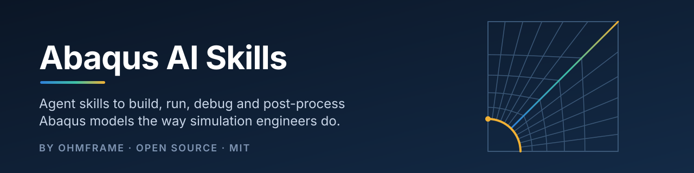

<p align="center">
  
</p>

<h1 align="center">Abaqus AI Skills</h1>

<p align="center">
  <strong>Teach your AI coding agent to build, run, debug and post-process Abaqus models the way simulation engineers do.</strong>
</p>

<p align="center">
  <a href="LICENSE"></a>
  <a href="#skills"></a>
  <a href="#requirements"></a>
  <a href="#requirements"></a>
  <a href="#validation"></a>
</p>

Seven focused skill packs that give an AI assistant the workflow, scripts and hard-won pitfalls for
real Abaqus work: build models by script, run them in batch, read the logs, fix the mesh, check the
energy balance and extract the numbers, with a hand check before any result is reported.

* **Built for agents.** The skills use the `SKILL.md` format that [Claude Code](https://docs.claude.com/en/docs/claude-code/skills)
  loads natively, plus an [`AGENTS.md`](AGENTS.md) index for Codex, Cursor, Gemini CLI and other tools.
* **Scripts, not screenshots.** Every model is a generic, parameterised Abaqus Python script (JSON spec or
  parameters at the top). Nothing project-specific, nothing clicked.
* **Checks built in.** Each skill says which check must pass before a number is quoted: hand calculation,
  reaction balance, mesh check or energy balance.
* **Verified on Abaqus 2023.** Every worked example runs end to end and matches its hand calculation;
  see [Validation](#validation) and the full [`TEST_REPORT.md`](TEST_REPORT.md).

> [!NOTE]
> **Verified on Abaqus 2023.** All seven skills were run end to end on Abaqus 2023 against their hand
> calculations, and the seven script bugs that run uncovered are fixed (v0.2.0). Results are in
> [Validation](#validation); every number, run time and fix is in [`TEST_REPORT.md`](TEST_REPORT.md).
> Abaqus 2024+ (Python 3 kernel) is next: [share your results](CONTRIBUTING.md#most-useful-right-now).

## Contents

* [Quick start](#quick-start)
* [Skills](#skills)
* [Example](#example)
* [Use with other AI tools](#use-with-other-ai-tools)
* [Requirements](#requirements)
* [Validation](#validation)
* [Roadmap](#roadmap)
* [FAQ](#faq)
* [Contributing](#contributing)

## Quick start

**1. Get the skills.**

```bash
git clone https://github.com/Ohmframe/abaqus-ai-skills.git
```

**2. Install them into your agent.** Each skill is a self-contained folder under `skills/`. Copy the ones
you want into your agent's skills directory.

For Claude Code:

```bash
# personal: available in all your projects
mkdir -p ~/.claude/skills && cp -r abaqus-ai-skills/skills/* ~/.claude/skills/

# or per project: commit them with the project
mkdir -p .claude/skills && cp -r abaqus-ai-skills/skills/* .claude/skills/
```

For agents that read `AGENTS.md` (Codex, Cursor and others), keep the repository inside your project
(for example as `abaqus-ai-skills/`) so the root [`AGENTS.md`](AGENTS.md) index and its relative paths
resolve. Details for each tool are in [Use with other AI tools](#use-with-other-ai-tools).

**3. Ask in plain language.** The agent picks a skill from its `description` when your request matches:

* "Build an Abaqus model of a 1 m steel cantilever with a 1 kN tip load and run it."
* "Why did my job abort? The files are in `./run3`."
* "Get the max Mises and the reaction force out of `Job-1.odb`."
* "Make this `.cae` open in Abaqus 2021."

The agent writes and adapts the scripts; they run on **your** machine with **your** Abaqus licence.
Many scripts are also useful on their own from the command line.

## Skills

| Skill | What it does | Status |
|---|---|---|
| [`abaqus-model-builder`](skills/abaqus-model-builder/SKILL.md) | Builds a native `.cae` + `.inp` from a JSON spec (parts, materials, sections, assembly, steps, contact/ties, BCs, loads, mesh, job), runs it in batch with a datacheck, and triages `.log/.sta/.msg/.dat` | Verified on Abaqus 2023 |
| [`abaqus-odb-extract`](skills/abaqus-odb-extract/SKILL.md) | Gets numbers out of an `.odb`: field max/min with location, reaction sums, histories, energies, de-duplicated contact forces, as CSV + `summary.json` | Verified on Abaqus 2023 |
| [`abaqus-mesh-doctor`](skills/abaqus-mesh-doctor/SKILL.md) | Diagnoses and fixes meshes: Analysis Checks, orange cells, free edges in STEP shell models, partitioning for structured/sweep hex | Verified on Abaqus 2023 |
| [`abaqus-version-compat`](skills/abaqus-version-compat/SKILL.md) | Rebuilds models for older releases, upgrades ODBs, lints scripts for the Python 2.7 (≤ 2023) and 3.10 (2024+) kernels | Verified on Abaqus 2023 (same-release round trip) |
| [`abaqus-explicit-impact`](skills/abaqus-explicit-impact/SKILL.md) | Drop tests, impactor hits, heavy-mass impacts, quasi-static pull-out or crush in Explicit, with energy-balance checks | Verified on Abaqus 2023 |
| [`abaqus-heat-transfer`](skills/abaqus-heat-transfer/SKILL.md) | Steady and transient conduction through layered build-ups, film boundaries, U-values and heat flux | Verified on Abaqus 2023 |
| [`abaqus-forming-fld`](skills/abaqus-forming-fld/SKILL.md) | Sheet-forming limits: dome-stretch models, FLD damage initiation, necking onset, FLD strain points | Verified on Abaqus 2023 (mechanics; material illustrative) |

*Verified on Abaqus 2023* means the skill's worked example was built, solved and post-processed on
Abaqus 2023 and matched its hand calculation. Key numbers are in [Validation](#validation).

Each skill folder has the same layout:

```
skills/<skill-name>/
  SKILL.md       # when to use it, files, workflow, checks before reporting, rules
  scripts/       # generic, parameterised Abaqus Python (and plain-Python helpers)
  references/    # checklists, API notes, pitfalls
  examples/      # a small textbook-style worked example with hand calculations
```

## Example

> [!NOTE]
> **Illustrative.** The exchange below shows the intended workflow; it was written by hand, not
> captured from a real session. The Abaqus column holds the numbers actually produced on
> Abaqus 2023 (see [`TEST_REPORT.md`](TEST_REPORT.md)).

**Prompt**

```text
Build the steel cantilever from the abaqus-model-builder example, run it, and tell me the tip
deflection and the support reaction. Check them against a hand calculation.
```

**Illustrative agent output**

```text
Using skills: abaqus-model-builder, then abaqus-odb-extract.

Units: mm-N-tonne-s-MPa. Spec: skills/abaqus-model-builder/examples/cantilever_beam.json
(L = 1000 mm, 100 x 50 mm section, E = 210 000 MPa, P = 1000 N at the tip via an RP + coupling).

1. python validate_spec.py cantilever_beam.json              -> 0 errors, 0 warnings
2. run_job.sh cantilever_beam.json Cantilever --datacheck     -> build, datacheck, run
3. python check_logs.py Cantilever                            -> completed, warnings explained
4. abaqus python odb_extract.py Cantilever.odb --field U:U2 --reactions FIXED_END \
       --history-set RP_TIP --out post

Check                     Hand calculation          Abaqus 2023
Tip deflection U2         -0.384 mm                 -0.38191 mm   (0.5 %)
Support reaction RF2      +1000 N                   +1000.00 N    (0.00 %)
S11 at mid-span           +/-6.0 MPa (surface)      5.400 MPa at the integration points

Report a result only if the tip deflection is within about 2 % of the hand value and the
reaction balances the load.
```

## Use with other AI tools

Only Claude Code reads the `SKILL.md` frontmatter as a skill natively. Every other tool below uses the
same files as ordinary instructions or context. The content is identical; only the loading differs.
Tool features change often: check each tool's current documentation.

* **Agents that read `AGENTS.md`** (for example OpenAI Codex, and Cursor in the project root): copy or
  clone this repository into your project (for example as `abaqus-ai-skills/`) and keep the root
  [`AGENTS.md`](AGENTS.md). It indexes the skills and tells the agent which `SKILL.md` to open for which task.
  Alternatively, paste the index into your own project's `AGENTS.md` and fix the relative paths.
* **Cursor rules**: create one rule per skill in `.cursor/rules/` (for example `abaqus-model-builder.mdc`),
  use the skill's `description` as the rule description so it is applied when relevant, and paste the
  `SKILL.md` body, or reference the file with `@` mentions in chat. Keep the `scripts/` and `references/`
  folders in the project so the paths in the skill resolve.
* **Gemini CLI**: Gemini CLI loads `GEMINI.md` context files and can import other Markdown files with
  `@path` lines. Either add `@./abaqus-ai-skills/AGENTS.md` (or individual `SKILL.md` files) to your
  `GEMINI.md`, or set `"context": {"fileName": ["AGENTS.md", "GEMINI.md"]}` in `.gemini/settings.json`.
* **ChatGPT / custom GPTs**: upload the relevant `SKILL.md` and `references/*.md` files (and scripts you want
  reviewed or adapted) as knowledge files or chat attachments, and put the skill's workflow in the GPT's
  instructions. ChatGPT cannot run your Abaqus installation: it can write and review scripts and interpret
  logs or CSV output you paste back; run the scripts yourself.
* **Any other assistant**: paste the `SKILL.md` of the task at hand into the conversation or system prompt,
  and attach the referenced scripts. Everything is plain text.

In every case the scripts run on **your** machine with **your** Abaqus licence; the AI only writes,
adapts and reads them.

## Requirements

* A **licensed Abaqus installation** (Abaqus/CAE for `abaqus cae noGUI=` scripts, the solver for jobs).
  Nothing here includes or provides licences, solvers or SIMULIA software.
* Target releases: **Abaqus 2020 to 2025**. The scripts are written for both Abaqus Python kernels:
  2.7 (Abaqus 2023 and older) and 3.10 (Abaqus 2024 and newer). Verified on Abaqus 2023; 2024+ validation is next.
* Helpers that do not touch Abaqus (`check_logs.py`, `validate_spec.py`, `py23_check.py`) run on any Python 2.7 or 3.
* Bash for the `.sh` helpers (Linux, macOS, WSL or Git Bash on Windows).

## Validation

All seven worked examples were built, solved and post-processed on **Abaqus 2023** (Standard, Explicit
and CAE; Python 2.7 kernel) and compared with their hand calculations. Full numbers, run times and the
seven fixes: [`TEST_REPORT.md`](TEST_REPORT.md).

| Skill | Status | Key result vs hand calculation |
|---|---|---|
| `abaqus-model-builder` | **Verified** | Cantilever tip deflection -0.38191 mm vs -0.384 mm (0.5 %); RF2 1000.00 N vs 1000 N (0.00 %) |
| `abaqus-odb-extract` | **Verified** | Reproduces every cantilever value from the ODB; field, reaction, history and energy extraction exercised on Standard, Explicit and heat-transfer ODBs |
| `abaqus-mesh-doctor` | **Verified** | Plate with hole Kt 3.20 vs 3.14 Heywood (1.9 %); RF1 -50 000 N vs -50 000 N (0.00 %); 0 Analysis Checks errors/warnings |
| `abaqus-version-compat` | **Partial** | Same-release export -> rebuild -> re-solve reproduces the cantilever exactly (-0.381909 mm, RF2 1000 N); cross-release path not yet tested |
| `abaqus-explicit-impact` | **Verified** | Drop test initial KE 12 500.01 mJ vs 12 500 mJ (0.0001 %); energy drift 0.022 %; energy balance PASS |
| `abaqus-heat-transfer` | **Verified** | Three-layer wall U 0.297884 vs 0.29788 W/m2K (0.00 %); interface temperatures within 0.01 degC |
| `abaqus-forming-fld` | **Verified (mechanics)** | Dome-stretch necking onset at 53.7 mm stroke; quasi-static KE/IE 0.145 % (PASS); material and FLC illustrative |

Automated on every push: Python 3 byte-compile, the Python 2/3 and Abaqus-API linter, `bash -n`,
`yamllint` and the confidentiality scrub (CI). Python 2.7 byte-compile runs before each release.

**Known limits**

* **Abaqus 2024+** (Python 3.10 kernel) is not yet tested; the scripts compile under Python 3 and pass the 2/3 linter.
* **`abaqus-version-compat`**: the cross-release (newer -> older) path is untested; only 2023 was available.
* **`shell_weld.py`**: the imprint-and-merge path still needs a real CAD STEP file to exercise it.
* **`abaqus-forming-fld`**: the default material and FLC are illustrative; use measured data for real parts.
* **Single mesh**: the plate Kt and the forming onset come from one mesh, without a convergence study.
* **Your model, your verification**: run each skill's checks on your own model before quoting a result.

Each example README lists its hand calculation. If your release gives a different answer, please
[open an issue](https://github.com/Ohmframe/abaqus-ai-skills/issues/new/choose) with the release and the output.

## Roadmap

* **Now (v0.2.0)**: seven Abaqus skills, verified on Abaqus 2023.
* **Next for Abaqus**: repeat the Abaqus 2023 test run on 2020-2022, 2024 and 2025, fix what breaks,
  and mark each skill as tested per release; test the genuine cross-release export/rebuild path.
* **COMSOL Multiphysics skills**: model building through the COMSOL API (Java, or Python via MPh),
  study set-up, and result extraction.
* **Ansys skills**: Mechanical / MAPDL scripting (APDL and PyAnsys), batch runs, and result extraction.
* **Your idea**: propose a skill with the [new skill template](https://github.com/Ohmframe/abaqus-ai-skills/issues/new/choose).

## FAQ

**Has this been run in Abaqus?**
Yes. All seven skills are verified on Abaqus 2023: every worked example was run end to end and matched its
hand calculation, and the seven bugs that run uncovered are fixed. See [Validation](#validation) and
[`TEST_REPORT.md`](TEST_REPORT.md). Abaqus 2024+ is next, and skills will be marked per release.

**Do I need an Abaqus licence?**
Yes. This repository contains no Abaqus software. Model building uses `abaqus cae noGUI=` (a CAE token);
ODB post-processing uses `abaqus python`, which does not need a CAE token.

**Which AI tools does it work with?**
Claude Code loads the skills natively. Codex, Cursor, Gemini CLI, ChatGPT and other assistants can use the
same files as instructions or context; see [Use with other AI tools](#use-with-other-ai-tools).

**Will the agent run Abaqus by itself?**
Only if your agent can run shell commands on a machine with Abaqus, and you allow it. Otherwise the skills
tell the agent to give you the exact commands and ask for the output.

**Does my model data leave my machine?**
The scripts run locally and send nothing anywhere. Whatever you paste into an AI tool goes to that tool's
provider under its terms. Keep confidential models out of tools you have not approved for them.

**Which Abaqus releases and Python versions?**
The target is Abaqus 2020 to 2025. Scripts avoid f-strings and other 3-only syntax so they run on the 2.7
kernel (2023 and older) and the 3.10 kernel (2024 and newer). `abaqus-version-compat` covers the API
renames between releases, such as `master`/`slave` to `main`/`secondary` in 2022.

**Can I use the scripts without an AI agent?**
Yes. Each script has its usage in its header and in the skill's `SKILL.md`.

**Is this affiliated with Dassault Systèmes or SIMULIA?**
No. See [Trademarks](#trademarks).

**Can OhmFrame do the work for us?**
Yes. See [Built by OhmFrame](#built-by-ohmframe).

## Disclaimer

These skills and scripts are provided "as is" (MIT licence). Finite element results depend on modelling
choices, input data and engineering judgement. **You are responsible for verifying every result**
(hand calculations, mesh convergence, energy balance, test data) before you use it for design, certification or
any decision. AI agents make mistakes: review what they generate.

## Trademarks

Abaqus is a trademark of Dassault Systèmes. This project is not affiliated with or endorsed by Dassault Systèmes.
Other product names are trademarks of their respective owners and are used only to describe compatibility.

## Built by OhmFrame

We are OhmFrame, an engineering simulation studio (FEA, CFD, scripting and automation).
These skills are a distilled version of how we deliver Abaqus work.

**Need it done for you?** Model building, debugging a failing job, mesh repair, explicit impact, thermal or
forming studies, or custom Abaqus automation for your team: **[ohmframe.com](https://ohmframe.com)**.

## Contributing

Issues and pull requests are welcome; see [CONTRIBUTING.md](CONTRIBUTING.md). Test reports from real
Abaqus releases are the most useful contribution right now. Please follow our
[Code of Conduct](CODE_OF_CONDUCT.md), and report security issues as described in [SECURITY.md](SECURITY.md).
Changes are listed in the [CHANGELOG](CHANGELOG.md).

## Licence

[MIT](LICENSE) © OhmFrame
